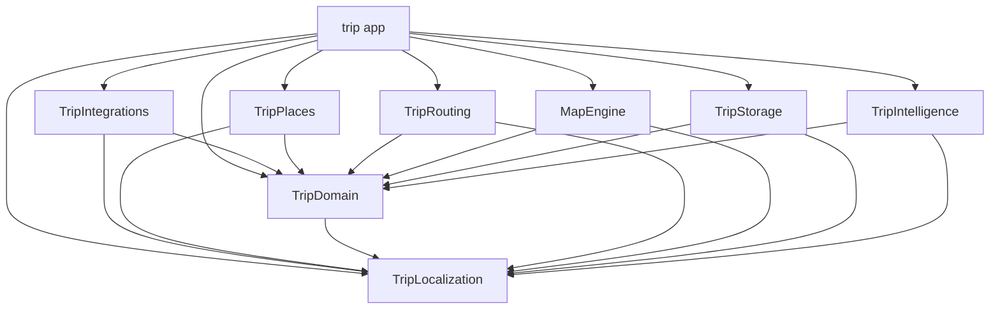

# Architecture and source ownership

Trip uses View–Controller–Model with eight local Swift package targets. Each
controller is a struct holding its model; observable UI state stays on MainActor.
Workers receive Sendable snapshots. No framework owns navigation or feature state.

```text
trip/                         App target
  App/                        Composition, cross-feature flows, navigation, intents
    Dependencies/             Production service factories
  Features/
    Explore/                  Map composition, catalog, location, layout
    Trips/                    Library, presentation, editing, assistant workflows
  DesignSystem/               Shared theme and interaction styles
  Shared/Places/              App-specific place presentation and autocomplete state
  Shared/System/              Host/extension entities, activity runtime, interaction intents
  Shared/Intelligence/        Host capability policy
  PreviewSupport/             Deterministic fixtures, compiled only in Debug
  Assets.xcassets/             App-owned images
  Resources/                  Bundled place data
TripWidgets/                  Widget extension, timeline models, and native activity layouts
Packages/TripKit/
  Sources/TripLocalization/    Shared text catalog, translations, typed accessors
  Sources/TripDomain/          Places, trips, service contracts
  Sources/TripPlaces/          Native text search, MapKit conversion, category mapping
  Sources/TripRouting/         Routing, directions UI/map content, framing, Maps links
  Sources/MapEngine/           Layout, collision, indexing, cache, merge policy
  Sources/TripStorage/         Private SwiftData records and local storage actor
  Sources/TripIntelligence/    Private generation schema and planning actor
  Sources/TripIntegrations/    Vision/PDF import, EventKit, AlarmKit, and WeatherKit adapters
Performance/                  Repeatable standalone checks and baselines
scripts/                      Ownership/context tools, source audits, builds, performance
templates/                    Feature, task, decision, and opt-in CI starters
docs/decisions/               Architecture rationale and tradeoffs
```

## Contents

- [Module graph](#module-graph)
- [Composition and state ownership](#composition-and-state-ownership)
- [Feature contracts](#feature-contracts)
- [Enforced boundaries](#enforced-boundaries)

## Module graph



The six implementation modules can compile independently once TripDomain and
TripLocalization are available. TripLocalization depends only on Foundation.
SwiftData schema edits do not create a dependency on the map engine;
itinerary generation changes do not make storage depend on Foundation Models.
Keep public APIs small: internal changes retain the best opportunity for cached
builds, while shared public API changes legitimately affect their consumers.

| Module | Exposed boundary | Private implementation |
| --- | --- | --- |
| TripLocalization | TripText labels, messages, counts, and deferred resources | Foundation-only catalog bundle; English, Kannada, and Hindi |
| TripDomain | Sendable values, TripLimits, PlaceProviding, TripStoring, ItineraryPlanning | No SwiftUI, SwiftData, or Foundation Models dependency |
| TripPlaces | PlaceTextSearch, PlaceFactory.make, PlaceCategory.mapCategories | Native search handle and category resolution; no app resources or feature state |
| TripRouting | Waypoints/options, provider, routes, Maps links, DirectionsModel, sheet/map content, map geometry | Native cancellation, leg assembly, route identity, auxiliary controls and search |
| MapEngine | Layout requests/results, layout actor, policies, geographic index, PlaceRepository | Ranking, spatial hash, sorted axes |
| TripIntegrations | TripBookingReader, AppleTripSystemActions, AppleTripWeatherService | Local document extraction, permission handling, export ledger, alarm reconciliation, bounded forecast cache |
| TripStorage | TripStore implementing TripStoring | ModelContainer, records, migrations, revision handling |
| TripIntelligence | TripPlanningService, TripStopOrderService, TripDetailSearchService implementing TripDetailSearching | Generable schemas, prompts, validation, geographic ordering, typed detail-query interpretation |

TripDomain still uses MapKit/CoreLocation for geographic values and search areas.
It is an Apple-platform domain module, not a platform-neutral networking schema.
Package targets do not read app resources. Explore’s ApplePlaceProvider supplies
live search results; local preview fixtures own bundled place-data loading.
TripPlaces owns MapKit item conversion and the cancellable text-search operation
used by both features; Trips never depends on Explore. Shared/Places retains
app annotation presentation and resource-backed colors. `DesignSystem/Colors.xcassets` is compiled into the app and
widget extension so both targets resolve the same semantic palette in their own
bundle. Package targets never read that catalog. Image assets retain their bundle
and names.

TripDomain owns PlaceSearchQuery's word matching/relevance and PlaceSearchResults'
bounded duplicate-listing policy. Explore's repository actor prepares cached result
snapshots; each feature retains its own cancellable search lifecycle. Trip lookup
combines native text, day and category filters while keeping raw field input separate
from its normalized saved-data query. See [search behavior](docs/Search.md).
Shared/Places owns the MainActor autocomplete adapter and native completion tokens;
TripDomain owns only immutable suggestion display values. Explore and trip pickers
own their independent query modes and resolution lifetimes. Submitted searches and
selected completions use native MapKit resolution before becoming real places.

## Composition and state ownership

| Scope | Owner | Contract |
| --- | --- | --- |
| App session | AppRuntime | Shared revisioned library and durable system publication |
| Window | AppModel | Explore, Trips, navigation, and host callbacks |
| Saved plans | TripLibraryModel | Mutation methods, revisions, load/save failures and retry |
| Transient workflows | Feature models | Drafts, search, generation, selection and presentation |
| Checklist and packing | TripChecklistModel | Window-local naming draft and packing session; shared library mutations |
| Collections | TripCollectionsModel | Naming/deletion sessions, notices, and saved-place edits through the shared library |
| Native services | AppTripServices | Production implementations injected through domain contracts |
| Previews | PreviewTripServices | Isolated local providers and deterministic values |
| System surfaces | Shared/System and TripWidgets | Bounded saved-data projections; no direct widget database access |

Features do not retain sibling models. App wires `ExploreEnvironment` and
`TripEnvironment` callbacks with weak captures. Models own behavior, views render
state, and struct controllers delegate actions. Read [App](docs/App.md) for host
flows and [Dependencies](docs/Dependencies.md) for provider lifetimes.

Checklist views use TripChecklistController. TripModel composes the workflow and
supplies feedback, Reminders review, and entity-identifier callbacks through
TripChecklistEnvironment. TripEditorView supplies section navigation. App enters
Trips workflows through semantic host methods; feature internals own their sequencing.

Collection views use TripCollectionsController. TripCollectionsModel owns its
editing sessions and collection mutations. TripCollectionsEnvironment delegates
map navigation and day insertion to the parent; the root retains save-sheet
dismissal and supplies section navigation at TripEditorView. Collections has no
root controller dependency and shares only the durable library with other workflows.

Durable edits use the library's mutation methods. Drafts carry stable identities
and validate current saved data before committing. Background work uses cancellation
and generation checks so late results cannot overwrite newer state. UI models stay
on MainActor; reusable workers exchange Sendable values.

## Feature contracts

| Change | Authoritative guide |
| --- | --- |
| Camera, projection, caching, annotation lifecycle | [Explore](docs/Explore.md) |
| Search, autocomplete, matching, saved-detail filters | [Search](docs/Search.md) |
| Directions host API, cancellation, geometry | [Directions integration](DIRECTIONS.md) |
| Trip editing, persistence, planning and journey events | [Trips developer guide](docs/Trips.md) |
| Civil dates, zones, DST and Today | [Destination times](docs/TripTimeAndToday.md) |
| App Groups, intents, widgets and activity data | [System integrations](SYSTEM-INTEGRATIONS.md) |
| Import, exports, alarms and weather | [Native travel services](docs/NativeTravelServices.md) |
| Adaptive navigation and window behavior | [Universal app](UNIVERSAL-APP.md) |
| Shared text and native metadata | [Localization](docs/Localization.md) |

Keep `MapProxy` inside live map callbacks; packages and actors receive plain
coordinates. TripRouting owns directions state and UI independently of Explore.
Trips depends on reusable routing contracts, never on Explore implementation types.

## Enforced boundaries

`Packages/TripKit/modules.json` records package dependencies.
`scripts/architecture/app-ownership.json` records app owners, permitted imports,
guides, and entry points. Feature folders share an app binary; package targets
provide separate compiler-enforced modules. Shared code and DesignSystem cannot
depend on app composition or features. PreviewSupport references require DEBUG guards.

TripPlaces is a compiler boundary for shared native adapters. Explore, Trips,
and their focused workflow owners still share the app module. This extraction
does not establish independent feature compilation or a measured build-time gain.

Run `python3 scripts/check_architecture.py` after moving sources or changing
module dependencies. It validates manifests, imports, linkage, source coverage,
and direct type references. Lexical checks cannot prove every inferred dependency;
compilation and review remain separate evidence. Update the guide and manifests
with a deliberate boundary change rather than weakening an allowance.

`bash scripts/check.sh` also audits source limits, previews, localization and
project skills. The standalone performance harness compiles selected production
files with `TRIP_STANDALONE`; app and package builds do not define that flag.
See [Contributing](CONTRIBUTING.md) for verification commands and
[Development](docs/Development.md) for change workflow.
