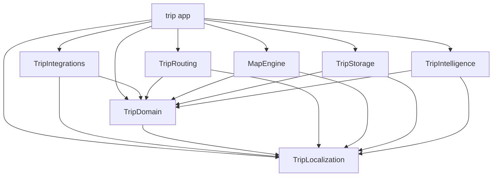
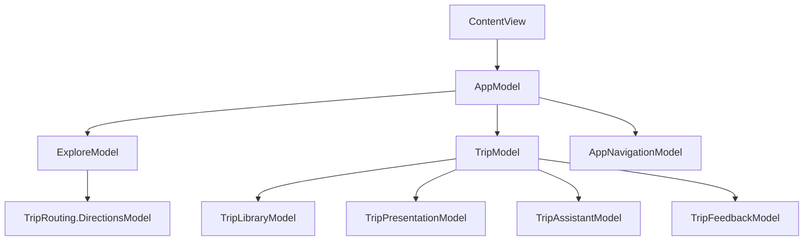

# Architecture and source ownership

Trip uses View–Controller–Model with seven local Swift package targets. Each
controller is a struct holding its model; observable UI state stays on MainActor.
Workers receive Sendable snapshots. No framework owns navigation or feature state.

```text
trip/                         App target
  App/                        Composition, cross-feature flows, navigation, intents
    Dependencies/             Production service factories
  Features/
    Explore/                  Map composition, catalog, location, layout
    Trips/                    Library, presentation, editing, assistant workflows
  DesignSystem/               Shared theme and interaction styles
  Shared/Places/              App-specific place presentation
  Shared/System/              Host/extension entities, activity runtime, interaction intents
  Shared/Intelligence/        Host capability policy
  PreviewSupport/             Deterministic fixtures, compiled only in Debug
  Assets.xcassets/             App-owned images
  Resources/                  Bundled place data
TripWidgets/                  Widget extension, timeline models, and native activity layouts
Packages/TripKit/
  Sources/TripLocalization/    Shared text catalog, translations, typed accessors
  Sources/TripDomain/          Places, trips, service contracts
  Sources/TripRouting/         Routing, directions UI/map content, framing, Maps links
  Sources/MapEngine/           Layout, collision, indexing, cache, merge policy
  Sources/TripStorage/         Private SwiftData records and local storage actor
  Sources/TripIntelligence/    Private generation schema and planning actor
  Sources/TripIntegrations/    Vision/PDF import, EventKit, AlarmKit, and WeatherKit adapters
Performance/                  Repeatable standalone checks and baselines
scripts/                      Ownership/context tools, source audits, builds, performance
templates/                    Feature, task, decision, and opt-in CI starters
docs/decisions/               Architecture rationale and tradeoffs
```

## Module graph



The five implementation modules can compile independently once TripDomain and
TripLocalization are available. TripLocalization depends only on Foundation.
SwiftData schema edits do not create a dependency on the map engine;
itinerary generation changes do not make storage depend on Foundation Models.
Keep public APIs small: internal changes retain the best opportunity for cached
builds, while shared public API changes legitimately affect their consumers.

| Module | Exposed boundary | Private implementation |
| --- | --- | --- |
| TripLocalization | TripText labels, messages, counts, and deferred resources | Foundation-only catalog bundle; English, Kannada, and Hindi |
| TripDomain | Sendable values, TripLimits, PlaceProviding, TripStoring, ItineraryPlanning | No SwiftUI, SwiftData, or Foundation Models dependency |
| TripRouting | Waypoints/options, provider, routes, Maps links, DirectionsModel, sheet/map content, map geometry | Native cancellation, leg assembly, route identity, auxiliary controls and search |
| MapEngine | Layout requests/results, layout actor, policies, geographic index, PlaceRepository | Ranking, spatial hash, sorted axes |
| TripIntegrations | TripBookingReader, AppleTripSystemActions, AppleTripWeatherService | Local document extraction, permission handling, export ledger, alarm reconciliation, bounded forecast cache |
| TripStorage | TripStore implementing TripStoring | ModelContainer, records, migrations, revision handling |
| TripIntelligence | TripPlanningService, TripStopOrderService, TripDetailSearchService implementing TripDetailSearching | Generable schemas, prompts, validation, geographic ordering, typed detail-query interpretation |

TripDomain still uses MapKit/CoreLocation for geographic values and search areas.
It is an Apple-platform domain module, not a platform-neutral networking schema.
No module reads app resources: the ApplePlaceProvider adapter in Explore owns
Bundle.main access. Shared/Places owns MapKit item conversion and the cancellable
text-search operation used by the day picker; Trips never depends on Explore. `DesignSystem/Colors.xcassets` is compiled into the app and
widget extension so both targets resolve the same semantic palette in their own
bundle. Package targets never read that catalog. Image assets retain their bundle
and names.

TripDomain owns PlaceSearchQuery's word matching/relevance and PlaceSearchResults'
bounded duplicate-listing policy. Explore's repository actor prepares cached result
snapshots; each feature retains its own cancellable search lifecycle. Trip lookup
combines native text, day and category filters while keeping raw field input separate
from its normalized saved-data query. See [search behavior](docs/Search.md).
Shared/Places owns the MainActor autocomplete adapter and native completion tokens;
TripDomain owns only immutable suggestion display values. Explore and trip pickers
own their independent query modes and resolution lifetimes. Submitted searches and
selected completions use native MapKit resolution before becoming real places.

## Composition and contributor contracts

[AppTripServices](trip/App/Dependencies/AppTripServices.swift) selects live storage
and intelligence implementations, plus native travel service adapters. Trips models require injected contracts and have
no live-service fallbacks. TripAIClient supplies a typed service factory,
availability, and error presentation; PreviewTripServices supplies isolated local
workers. TripStopOrderSuggesting makes local ordering substitutable as well.
The ownership manifest rejects TripStorage, TripIntelligence, TripIntegrations, SwiftData, and
FoundationModels imports in Trips. See [dependency lifetimes](docs/Dependencies.md).

Trip model files are grouped by workflow under Models (Workspace, Library,
Assistant, Checklist, Lookup, Editing, Journey, Scheduling, Planning, Search, Map,
Ordering, Tracking, BookingImport, SystemActions, Weather, Presentation, and Dependencies). Views and controllers retain
their existing feature boundaries; source moves do not change persisted schemas.

`python3 scripts/workspace.py context <Owner> --json` produces a context packet
from the same manifests used for enforcement. [Development](docs/Development.md)
documents the feature workflow and templates; [Testing](docs/Testing.md) describes
future coverage without adding test targets. The source gate also verifies compiler
policy and context-guide references. These guards supplement compilation and review.

## Feature boundaries

Explore contains the native MapReader/MapProxy lifetime and camera orchestration.
Only plain projected coordinates reach MapEngine. Keep MapProxy out of actors,
delayed tasks, caches, and package APIs.

MapEngine streams geographic candidates through a bounded unique-ID ranking
buffer before live projection. The repository actor owns coverage-aware cached
`PlaceSearchResponse` values with original fetch times; `PlaceSearchHistory`
separates successful coverage from short failure cooldowns. Explore owns pending
debounce and active request cancellation. See [Explore](docs/Explore.md).

Directions lives entirely in the TripRouting package, independently of Explore.
Its controller stores DirectionsModel,
which accepts routing, search, location, close, sheet geometry, and tint dependencies.
TripRouting owns the public routing API, native MapKit adapter, bounded tasks,
stale-response protection, native sheets, route map content, projection exclusions,
delayed route fitting, and viewport geometry. Its mobile UI is compiled for iOS
and visionOS; the engine and geometry also support macOS. Explore provides the
integration through DirectionsEnvironment, supplies measured frames, applies camera
transitions, and keeps MapProxy local. Widget/intent Maps links also use TripRouting.
See [DIRECTIONS.md](DIRECTIONS.md) for API and host lifecycle requirements.

AppRuntime shares one revisioned TripLibraryModel and system publisher with app intents.
Each ContentView owns its AppModel; map state, navigation, drafts, assistant, search,
and sort stay local to that window. SceneStorage restores the tab and selected trip.
Focused commands act on the current window; foreground intents queue validated destinations.
Previews inject independent models. AppModel owns ExploreModel,
TripModel, and AppNavigationModel. AppController delegates app lifecycle and launch
actions to that model. AppExploreView owns the save sheets that connect the map
and trip planner, including the sheet nested inside place details.

Explore never owns or refers to TripModel, TripController, or app navigation.
ExploreEnvironment supplies optional save, dismiss-save, and save-state callbacks.
TripEnvironment supplies show-Explore and show-place callbacks; Trips never refers
to ExploreModel. AppModel wires these callbacks with weak captures. A standalone
Explore host without a save callback hides Save to Trip. The app enables it.

TripModel composes TripLibraryModel, TripPresentationModel, TripAssistantModel,
TripTrackingModel, and TripFeedbackModel. The library owns read-only trip snapshots,
load/save errors, and revisioned persistence. Window-local presentation owns filtering, drafts,
confirmation targets, pending saves, and the selected trip. Each trip edit owns an identified draft; cancelling discards it,
and saving merges changed fields into the current library snapshot. New trips created
from the library open immediately; creation while saving a place returns to the map. Assistant state
and generation cancellation remain independent. TripLibraryModel accepts any
TripStoring; TripAssistantModel accepts any ItineraryPlanning.

All durable edits use the library's insert, update, updateDay, updateCollection,
or remove methods. Updates operate on a value copy and commit only when the edit
returns true; a successful edit always schedules persistence. Callers cannot mutate
the library's trip array directly. TripLimits and TripPlan.savedPlaces belong to
TripDomain so controls, editing workflows, and generation share the same policy.

TripDomain also owns optional day schedules, stop timing values, and deterministic
timeline calculation. Trip presentation owns isolated schedule drafts; controllers
route native form bindings and guarded saves through the shared library. Timelines
use manual travel allowances, with no service calls or package dependency changes.

TripDomain owns civil dates, zoned booking endpoints, strict DST resolution, and
the saved-data Today projection. TripPlan's destination calendar anchors days;
booking endpoints retain their own dates and zones. Trip presentation owns
reviewed migration, occurrence pickers, and the Today destination inside Trips.
Today delegates directions through TripEnvironment and events through existing
editing sessions. See [destination times and Today](docs/TripTimeAndToday.md).

TripDomain also owns typed `TripEvent` values and the mixed journey projection.
Events are stored once per trip with stable day endpoints; `TripDay.itemOrder`
holds mixed event/place identities. Multi-day rows project the same event record.
The existing JSON payload defaults missing fields for older trips. Event editing
uses isolated `TripEventDraft` sessions and the library's revisioned update path;
drafts reject stale event or day/date changes. Events do not become map places or
enter place-time calculations. See [Trips](docs/Trips.md#complete-journey-timeline).



Feature views share the app target, but their source dependencies are enforced by
`scripts/architecture/app-ownership.json`. Explore consumes Directions through the
TripRouting product; no app-owned Directions source remains. Trips has no
sibling-feature dependencies. Shared Places, System, and IntelligenceConfiguration have separate ownership entries.
Explore depends only on Places; Widgets only on System. Shared capabilities and
DesignSystem cannot depend on features or app composition. PreviewSupport is
allowed in DEBUG blocks only. These are source boundaries, not separate binaries;
use package targets for reusable workers and do not claim independent app-feature
compilation. Feature entry points and change recipes are linked from CONTRIBUTING.

The widget extension compiles Shared/System definitions alongside TripDomain,
TripStorage, and TripRouting for Maps directions URLs. AppSystemModel publishes bounded projections after durable saves and
serializes Spotlight indexing. Widgets read the App Group projection, never the
private SwiftData database. On iOS, interactive LiveActivityIntent actions run in the host
process and validate trip/day/stop identities before updating progress. The architecture
audit checks shared source membership, embedding, matching entitlements, and host
Live Activity metadata. Native visionOS builds share the same domain, storage,
widgets, and visit progress; ActivityKit sources remain iOS-only. See [SYSTEM-INTEGRATIONS.md](SYSTEM-INTEGRATIONS.md).

TripSurfaceDay includes optional, bounded mixed agenda items so older App Group
snapshots still decode. TripSurfaceAgenda and TripDayBriefing own deterministic
journey projection and exact-date summaries. TripDetailQuery filters those saved
items; TripDetailSearchService uses Foundation Models only to interpret a bounded
question into a category, day, and optional name. TripLookupModel owns cancellable
window-local lookup state, with TripLookupController and native list views. The
displayed result always comes from saved data, not generated prose. App-only
intents expose the lookup and day briefing; the widget target does no inference.

TripDetailAnswer assembles spoken summaries and result scopes from saved projections.
AskTripQuestionIntent reuses the Trips lookup interpreter through AppRuntime, checks
that the itinerary days are unchanged after generation, and returns typed detail entities.
Its reusable snippet stores the resolved category, stable day ID, and name filter;
refresh reads current saved data without another model request. TripDetailSpotlightIndex
publishes at most 300 upcoming detail entities through the existing serialized index
owner. It removes obsolete IDs after edits and includes neither notes nor checklist text.

TripNextStep derives the active next visit or today's saved commitment from canonical
trip data and recorded visits. TripSurfaceAgenda shares stable upcoming priorities
and explicit start/end boundaries with widgets. AppRuntime resolves an explicit trip,
active tracking, or an unambiguous current trip; snippets reload after durable edits
and visit changes. Detail links carry trip/item identities and validate them after
loading, preserving editing sessions. The same lookup powers the Next item control.
TripSurfaceSelection reconciles the widget's day/session pair. Active overnight
tracking keeps its chosen day; ended sessions yield to the current or next planned
day. A retained same-day session excludes visited places without hiding bookings.

Foreground place-search intents carry a bounded text query and canonical trip/day
identities through AppLaunchModel. AppRuntime validates the request; AppModel
revalidates the destination and editing state when a scene consumes it, then opens
the existing TripSavedPlacePickerModel. Only the existing explicit Add action
persists a place. This handoff does not create a second search or saving service.

## Incremental work

Packing preparation uses TripPackingContext and TripChecklistEditing in TripDomain,
with the on-device TripPackingService in TripIntelligence. A window-local packing
model owns generation/review; durable additions use the shared library update path.
Authenticated checklist intents resolve composite trip/item identities in AppRuntime.
Only TripChecklistProgress counts enter system projections. Foreground controls use
the shared TripControlNavigation handler installed by app composition; Shared never
depends on AppRuntime. Departure widgets refresh at civil midnight and durable edits.

Start with the feature that owns the behavior. Change one layer at a time, keep
same-file previews beside their views, and expose new domain or worker APIs only
when another target needs them. Avoid umbrella imports, exported imports, and
public SwiftData or generated Foundation Models types.

`Packages/TripKit/modules.json` records the package graph;
`scripts/architecture/app-ownership.json` records app source ownership and allowed imports.
`python3 scripts/check_architecture.py` validates these graphs, source coverage,
package imports, app-type references, Xcode linkage, and performance source paths.
It detects direct type references with lexical analysis; it is not a Swift compiler
and cannot prove dependencies reached through inferred values or every language
construct. Keep the manifests and the relevant contract guide in the same change
when deliberately adding a boundary. Do not add an allowance just to silence a leak.

`bash scripts/check.sh` also runs the SwiftSyntax source audit (physical line
limits, named-preview presence, controller storage, forbidden UIKit) and diff
whitespace checks. These checks compile neither the app nor package products.
Build and benchmark only when requested, following CONTRIBUTING.

The performance tools deliberately compile selected production files into one
standalone executable so they can examine internal algorithm details. Only those
files guard imports with TRIP_STANDALONE. App and package builds never define it.
This is not a second implementation of the algorithms.

Shared copy, bundle ownership, native metadata, and translation workflow are described
in [Localization](docs/Localization.md).

Day rehearsal and place insertion share a window-local TripPlanningDraft. The
original day, dates, zone and bookings are checked again before an atomic library
update. The draft preserves fixed-arrival boundaries and booking records; changes
to visit order keep mixed event slots. TripDomain owns insertion ranking, guarded
reordering and booking-overlap calculation. Trips now consumes TripRouting's
public engine through a dedicated provider per draft. Cached route geometry stays
MainActor-owned, with a 350 ms debounce, 25-second batch deadline, generation
checks, 12 new requests per refresh and a 256-route cache. Missing routes remain
explicit; straight connectors never claim to be directions or travel estimates.

Save-placement ranking runs in a dedicated actor from a cancellable view task.
The view owns a small observable result model; request identity and generation
checks reject obsolete recommendations after changing trips, places, or days.
No geographic ranking runs inside a view body.
