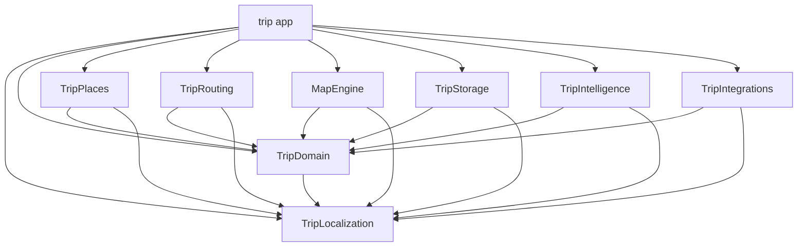

# Architecture and source ownership

Trip has two app features, Explore and Trips, composed by an App host, plus eight
local Swift package products. Start with the owner of the behavior you want to
change; a screen does not automatically need a new module.

Use `python3 scripts/workspace.py context <Owner> --json` for source paths,
consumers, and contracts. Setup and verification are in [Contributing](CONTRIBUTING.md).

## Find the right layer

| Location | Responsibility | Guide |
| --- | --- | --- |
| `trip/App` | Scene composition, navigation, production services, intents and system publication | [App](docs/App.md) |
| `trip/Features/Explore` | Map discovery, camera, selection and place details | [Explore](docs/Explore.md) |
| `trip/Features/Trips` | Saved library, editing, planning and travel workflows | [Trips](docs/Trips.md) |
| `trip/DesignSystem` | Shared visual tokens and components | [Design system](docs/DesignSystem.md) |
| `trip/Shared/Places` | App autocomplete state and resource-backed place presentation | [Search](docs/Search.md) |
| `trip/Shared/System`, `TripWidgets` | Shared entities, bounded snapshots, widgets and activities | [System integrations](SYSTEM-INTEGRATIONS.md) |
| `trip/Shared/Intelligence` | Host capability and entitlement policy | [Dependencies](docs/Dependencies.md) |
| `trip/PreviewSupport` | DEBUG-only local fixtures | [Previews](docs/PreviewSupport.md) |
| `Packages/TripKit` | Reusable domain, native adapters, algorithms and storage | [TripKit](Packages/TripKit/README.md) |

Views render state and delegate actions to struct controllers whose only stored
property is their model. MainActor models own mutable UI state and behavior;
smaller workflow models own independent drafts and requests. Actors and concurrent
workers receive Sendable values. Keep `MapProxy` inside live map callbacks.

## Module graph

The package targets iOS, macOS and visionOS 27.3; the app targets iOS/iPadOS and
visionOS 27.3. Swift 6 and MainActor default isolation apply throughout. The six
implementation modules depend on TripDomain and TripLocalization, not each other.
Package code never depends on app types or app assets. TripDomain still uses
MapKit/CoreLocation; it is an Apple-platform domain module.

TripRouting owns reusable directions state and SwiftUI UI. TripPlaces owns native
search operations and MapKit conversion used by both features. App autocomplete,
colors and resource loading stay outside that package. The semantic color catalog
is included in both app and widget bundles; packages do not read it.

## Composition and state ownership

| Lifetime | Owner | Contract |
| --- | --- | --- |
| App session | `AppRuntime` | Shared revisioned library and durable system publisher |
| Window | `AppModel` | Explore, Trips, navigation and host callbacks |
| Saved data | `TripLibraryModel` | Canonical snapshots, mutation methods and load/save recovery |
| Trip workspace | `TripModel` | Workflow composition and cross-workflow actions |
| Checklist and packing | `TripChecklistModel` | Naming draft, packing session and injected generation worker |
| Collections | `TripCollectionsModel` | Naming/deletion sessions and saved-place edits |
| Native services | `AppTripServices` | Explicit production factories and shared service lifetimes |
| Component preview | `PreviewTripServices` | Isolated local providers and deterministic values |

App connects `ExploreEnvironment` and `TripEnvironment` with weak captures.
Features do not retain one another or decide the host's tab navigation. App enters
Trips through semantic host operations; Trips sequences its own child workflows.
Checklist and Collection views receive their focused controllers. The parent
supplies section navigation and cross-workflow callbacks rather than exposing its
entire controller to those subtrees.

All durable edits go through the library. Drafts carry stable identities, revalidate
current saved data, and merge only their intended changes. Cancellation and
generation checks prevent old async results from replacing newer work. See
[Dependencies](docs/Dependencies.md) for factories and [App](docs/App.md) for delivery
and durable publication lifetimes.

## Enforced boundaries

[`modules.json`](Packages/TripKit/modules.json) records package edges and must match
[`Package.swift`](Packages/TripKit/Package.swift).
[`app-ownership.json`](scripts/architecture/app-ownership.json) records app owners,
permitted dependencies, guides and entry points. Shared code and DesignSystem
cannot depend on features or app composition; PreviewSupport references require
DEBUG guards.

Package targets are compiler boundaries. Explore, Trips and focused workflow
folders still share the app module: their source boundaries are checked lexically.
TripPlaces does not make either full feature independently compilable. Neither
folder organization nor the module graph establishes a measured build-time gain.

After moving sources or changing dependencies, update the manifests and owning
guide together and run `python3 scripts/check_architecture.py`. Direct-reference
checks cannot prove every inferred dependency; compilation and review remain
separate. Keep public APIs small and justify new modules by actual consumers or
independent ownership, not file count.

## Related contracts

- [Trips](docs/Trips.md), [destination times](docs/TripTimeAndToday.md), and [search](docs/Search.md).
- [Directions integration](DIRECTIONS.md), [native services](docs/NativeTravelServices.md), and [adaptive layouts](UNIVERSAL-APP.md).
- [Localization](docs/Localization.md), [testing](docs/Testing.md), and [development workflow](docs/Development.md).
- [Architecture decisions](docs/decisions/README.md) explain the tradeoffs behind these boundaries.
