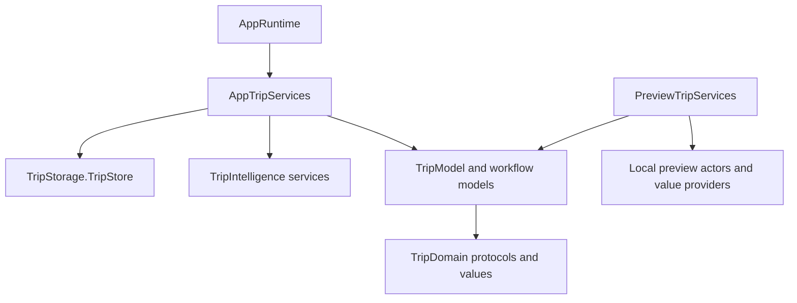

# Dependency ownership and lifetimes

The composition root chooses live services; feature models accept contracts.
This keeps previews local and creates seams for future tests without a global
service registry. Existing window, task, and persistence lifetimes remain explicit.

| Boundary | Host supplies | Lifetime |
| --- | --- | --- |
| TripLibraryModel | any TripStoring | One shared library and revision sequence per store session |
| TripAssistantModel | TripAIClient<any ItineraryPlanning> | Window-local state; fresh service for selected processing mode |
| TripLookupModel | TripAIClient<any TripDetailSearching> | Window-local query or isolated intent lookup |
| TripPackingModel | TripAIClient<any TripPackingPlanning> | Window-local suggestions; on-device factory per request |
| TripStopOrderModel | any TripStopOrderSuggesting | Isolated review; caller owns async task cancellation |
| TripModel | Library, workflow models, ordering service, tracking | One per scene; only durable library is shared |
| ExploreModel | PlaceProviding and MapConfiguration | One map per window; repository owns its cache |
| DirectionsModel | DirectionsProviding and DirectionsEnvironment | Host-retained routing session |

`TripAIClient` is a small immutable MainActor value containing a typed factory,
availability policy, and error-to-message function. Workers remain Sendable actors
or values. Availability and failures can be controlled independently of device
eligibility in previews and future tests. The live host combines its entitlement
policy with TripAIAvailability. TripAIFailure owns service-specific message mapping
inside TripIntelligence; the Trips feature imports neither FoundationModels nor
TripIntelligence. No optional service silently falls back to a live implementation.

AppRuntime retains the shared library and connects its successful saves to system
publishing. AppTripServices makes each scene's workflow models. Intents construct
their isolated assistant/lookup through the same factory. AppModel connects host
callbacks between Explore and Trips. It does not let either feature own the other.

Use `PreviewTripServices.makeTrips(plans)` for local Trips composition. Each call
creates its own PreviewTripStore actor and deterministic planning providers.
It never opens SwiftData or calls Foundation Models. Lookup previews return a
fixed stays query; they are fixtures, not a natural-language interpreter. Maps
may still require system basemap data. ContentView previews intentionally use
live app composition and remain labeled accordingly.

Shared code has three separately enforced capabilities: Places, System, and
IntelligenceConfiguration. Explore can consume Places; it cannot reach into shared
system persistence. Widgets consume System and cannot depend on feature models or
inference. App and Trips use only their declared capabilities. DesignSystem owns
visual primitives and has no feature dependency. These are source boundaries in
the app target; reusable packages provide actual compiler-enforced module boundaries.

## Native travel services

AppTripServices retains one booking reader actor, configured weather provider, and MainActor
AppleTripSystemActions adapter. Each scene receives independent import, export, and
weather models. Trips imports only their TripDomain contracts. PreviewTripServices
injects local document, weather, and system-action fixtures without permission prompts.

The system adapter retains EventKit stores and a durable export/alarm ledger. Successful
trip saves and foreground activation reconcile pending alarms with canonical bookings.
Import and forecasts use cancellation plus generation checks. No provider is created
inside a view or silently substituted after a failure. See [native travel services](NativeTravelServices.md).

The current Personal Team configuration injects UnavailableTripWeatherService.
A host explicitly enabled and provisioned for WeatherKit injects the shared
AppleTripWeatherService actor/cache. Previews always use a local provider.
